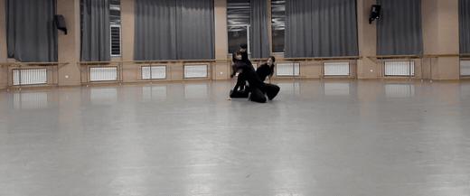
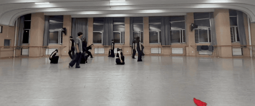

# 现代舞作品 · 《关系》《卡农》

**导演　王晓雨**

两部现代舞作品的演出录像，附作品简析。

**▶ [打开网页播放页](https://duyuanfu.github.io/dance-show/)** — 大屏播放器、可切换画质、完整简析

| 作品 | 时长 | 形式 | 关键词 |
| :--- | :--- | :--- | :--- |
| [《关系》](#关系) | 02:46 | 四人舞 | 防备 · 算计 · 相互消耗 |
| [《卡农》](#卡农) | 05:52 | 群舞 | 压抑 · 累积 · 挣扎 · 突破 |

视频为固定机位的现场录制。**在线观看**会在浏览器里直接播放（支持全屏），**高清原片下载**适合本地存档。

---

## 《关系》



▶ **[在线观看](https://cdn.jsdelivr.net/gh/duyuanfu/dance-show@main/videos/guanxi.mp4)**　·　[高清原片下载](videos/hd/guanxi-hd.mp4?raw=true)（13 MB）

`02:46` ｜ 四位舞者 ｜ 现代舞

### 作品简析

这部现代舞作品以四个人之间的对抗关系为核心，表现人在复杂关系中的防备、算计与相互消耗。四个人曾经同属一个群体，但信任早已破裂。他们表面上维持默契，实际上每个人都在观察别人、隐藏自己，并寻找击破对方的机会。

作品开场时，四个人互相对视。这种对视并不是亲近，而是一种审视、试探和压迫。每个人都从别人的目光里读出危险，却又不愿先暴露自己的真实想法。对视让舞台一开始就充满紧张感，仿佛一场无声的博弈已经开始。

随后，他们的身体逐渐呈现出收缩、低重心、停顿等状态，表现出戒备与压抑。随着关系推进，四个人开始两两试探：有人试图控制，有人伪装顺从，有人敏感多疑，有人沉默等待。中段曾出现短暂的群体同步，看似形成合作，实则只是每个人都在利用集体保护自己。随后平衡破裂，对抗逐渐爆发，动作变得尖锐、推拉、失衡。

结尾处，四个人同时逼近中心，却又在同一瞬间停下。没有人真正胜利，也没有人完全失败。他们彼此牵制，彼此消耗，最终被困在同一种关系里。

整部作品的情感从对视中的试探开始，经历压抑、伪装、对抗，最后落在无法解脱的僵持感。它想表达的不是谁打败谁，而是人在对抗中如何被关系困住：每个人都想控制别人，却最终都无法真正逃离彼此。

---

## 《卡农》



▶ **[在线观看](https://cdn.jsdelivr.net/gh/duyuanfu/dance-show@main/videos/canon.mp4)**　·　[高清原片下载](videos/hd/canon-hd.mp4?raw=true)（33 MB）

`05:52` ｜ 群舞 ｜ 现代舞

### 作品简析

这部现代舞作品整体呈现出一种由压抑到冲破、由束缚到释放的情感轨迹。作品前半部分以压抑、沉闷、克制的情绪为主，舞者的身体状态多表现为收缩、蜷曲、低重心的移动，动作带有明显的阻滞感和无力感，仿佛被某种无形的压力包围。情绪并不是直接爆发，而是在反复的重复、延迟和累积中逐渐加重，形成一种「被困住」的心理氛围。

随着作品推进，压抑感开始松动。舞者之间出现更多错落的呼应，动作由被动承受转向主动伸展，身体线条逐渐打开，空间使用也从封闭转向扩张。到作品后半段，情绪达到转折：原本被压制的力量被释放出来，动作变得果断、延展、具有冲破感，仿佛个体终于从长期束缚中挣脱出来，完成了一次由内而外的自我突破。整部作品的情感因此呈现出「压抑—累积—挣扎—突破—释放」的清晰层次。

在技法上，作品运用了卡农结构来强化这种情绪变化。**卡农依次**使动作像波浪一样依次传递，形成连绵不断的压迫感，也暗示个体情绪在群体中的扩散；**卡农间**通过时间上的错位，让相同或相似动作在不同舞者身上先后出现，营造出被困在循环中的感受；**卡农复数**则以多个动作线索并行展开，使舞台情绪更加复杂，仿佛多种压力同时作用在个体身上；**卡农变数**在重复中加入力度、方向、节奏或身体形态的变化，让原本一致的压抑动作逐渐产生裂痕，为突破埋下伏笔；**卡农个体**突出单个舞者的挣扎与觉醒，使观众能清晰感受到「我」从群体束缚中分离出来的瞬间；而**卡农群体**则在结尾处将个体突破扩展为集体释放，形成更强的情感共振。

通过卡农技法的层层推进，作品把「压抑」处理成一种可以被看见、被传递、被积累的身体经验；而最后的突破也因此不只是情绪宣泄，而是经过长期累积后形成的必然释放。

---

## 文件说明

```
videos/      在线观看版（H.264，约 9 MB，浏览器可直接播放）
videos/hd/   高清原片（供下载，体积较大）
assets/      片段预览动图
```

> **关于播放**：GitHub 的文件页面不会加载视频播放器（超过几 MB 就只显示「View raw」），所以「在线观看」链接指向 jsDelivr CDN，它返回正确的 `video/mp4` 类型，点开即在浏览器内播放、可全屏。若链接失效，也可直接下载高清原片观看。

本仓库仅用于作品展示，视频版权归创作者所有，未经许可请勿转载或商用。
